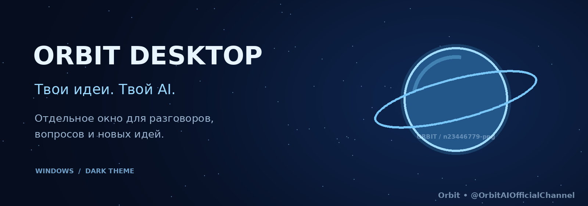
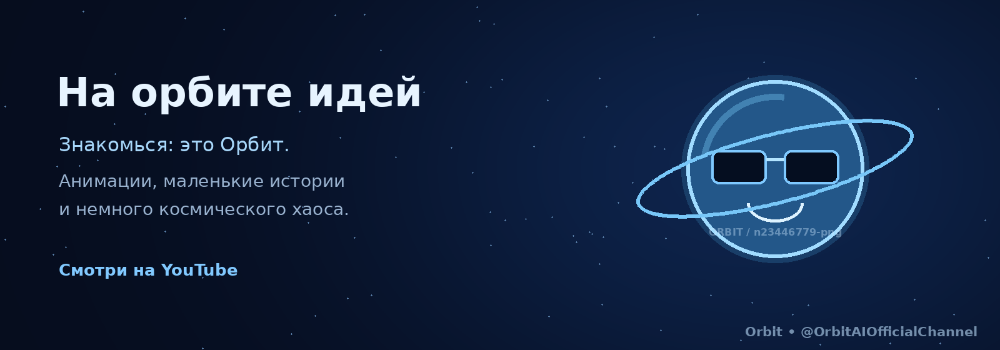

# ✦ Orbit Desktop

### Твои идеи. Твой AI.

Твой AI-помощник в отдельном приложении.  
Минималистичный интерфейс, тёмная тема и пространство для твоих идей.

---

## О проекте

Orbit Desktop — приложение для общения с AI в отдельном окне.

Тёмная тема, мягкие акценты и лаконичный интерфейс — чтобы
сосредоточиться на разговоре, вопросах и новых идеях.

Предпочитаешь браузер? Открой
[веб-версию Orbit](https://orbit.nikitoslox666.workers.dev/).

## Скачать

Перейди на
[страницу Orbit Desktop](https://orbit.nikitoslox666.workers.dev/dowloandapp)
или открой
[Releases](https://github.com/n23446779-png/Orbit-desktop/releases)
с готовыми сборками.

Доступные форматы указаны в конкретном релизе:

- Установщик — для установки приложения на компьютер.
- Portable-архив — для запуска без установки.

## Как запустить

### Установщик

1. Скачай установщик из официального релиза.
2. Запусти его и следуй инструкциям.
3. Открой Orbit Desktop.

### Portable-версия

1. Скачай архив из официального релиза.
2. Распакуй его целиком в отдельную папку.
3. Запусти `Orbit.exe` из распакованной папки.

> Не запускай приложение прямо из архива и не переноси один
> `Orbit.exe` отдельно от остальных файлов.

## Подключение модели

Открой настройки моделей и укажи данные своего API-подключения.

Доступность моделей, ограничения и стоимость запросов зависят
от выбранного провайдера. Скачивание Orbit Desktop само по себе
не предоставляет API-ключи или оплаченный доступ к сторонним сервисам.

> Не публикуй API-ключи, токены и другие секретные данные.

## Орбит и наш канал

Орбит — наш космический талисман: любопытная планета в очках,
у которой одна маленькая идея легко превращается в целую вселенную.

На канале — анимации и короткие истории с Орбитом.
Его главное правило: «Так. Без паники».

## Ошибки и предложения

Нашёл проблему или придумал улучшение?
Создай обращение в
[Issues](https://github.com/n23446779-png/Orbit-desktop/issues).

Для сообщения об ошибке укажи:

- версию Orbit Desktop;
- версию Windows;
- действия, после которых возникла проблема;
- ожидаемый и фактический результат;
- скриншот или текст ошибки, если они есть.

Обращения в Issues публичные. Перед отправкой удали со скриншотов
и из логов API-ключи, токены и личные данные.

## Лицензия

Orbit Desktop распространяется по проприетарной пользовательской
лицензии и не является проектом с открытым исходным кодом.

Использование официальной сборки разрешено на условиях лицензии.
Изменение и повторное распространение принадлежащих правообладателю
компонентов без письменного разрешения запрещены, кроме случаев,
предусмотренных лицензией и применимым законодательством.

Полные условия — в файле [LICENSE.txt](./LICENSE.txt).

Сторонние компоненты регулируются собственными лицензиями.

## Автор

[n23446779-png](https://github.com/n23446779-png)  
Также известен как nikitoslox666 и lolhol6p.

---

✦ Orbit — Твоим идеям есть место.

