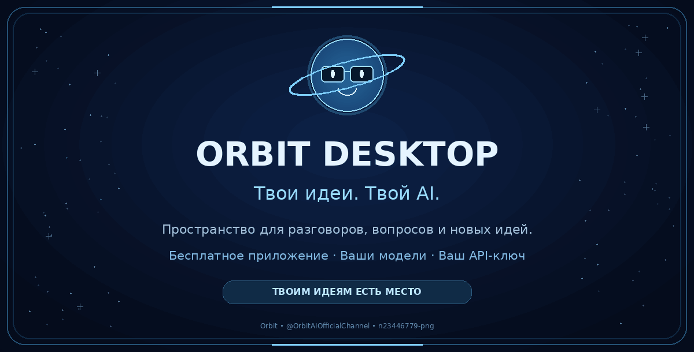
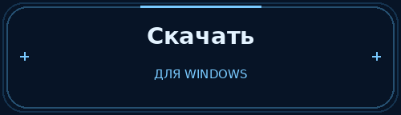
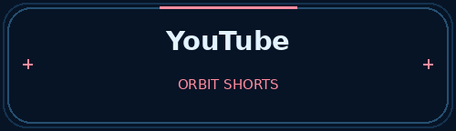
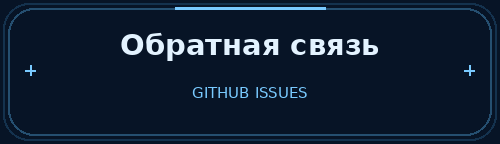
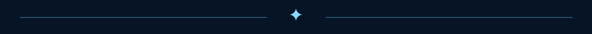

  

Бесплатное приложение для общения с AI-моделями через ваш API-ключ.  
Доступ к моделям предоставляется вашим провайдером и может быть платным.

[Сайт](https://orbit.nikitoslox666.workers.dev/) · [Скачать](https://orbit.nikitoslox666.workers.dev/dowloandapp) · [YouTube](https://www.youtube.com/@OrbitAIOfficialChannel/shorts) · [Issues](https://github.com/n23446779-png/Orbit-desktop/issues)

## Пространство для ваших идей

Orbit Desktop — бесплатное приложение для общения с AI-моделями в отдельном окне.

Тёмная тема, мягкие акценты и лаконичный интерфейс — чтобы сосредоточиться на разговоре, вопросах и новых идеях.

Предпочитаете браузер? Откройте [веб-версию Orbit](https://orbit.nikitoslox666.workers.dev/).

## Ваши модели. Ваш API-ключ.

Orbit предоставляет интерфейс для общения, но не включает собственную AI-модель, API-ключи или оплаченный доступ к сторонним сервисам.

Вы сами выбираете провайдера и модель, подключаете свой API-ключ и используете их на условиях выбранного сервиса.

Скачивание и использование Orbit Desktop бесплатны. Стоимость запросов, доступность моделей и лимиты зависят от вашего API-провайдера.

## Скачать Orbit Desktop

Готовые сборки — на [странице загрузки](https://orbit.nikitoslox666.workers.dev/dowloandapp) и в [Releases](https://github.com/n23446779-png/Orbit-desktop/releases).

Доступные форматы указаны в конкретном релизе: установщик или portable-архив.

### Установщик

1. Скачайте установщик из официального релиза.
2. Запустите его и следуйте инструкциям.
3. Откройте Orbit Desktop.

### Portable-версия

1. Скачайте архив из официального релиза.
2. Распакуйте его целиком в отдельную папку.
3. Запустите `Orbit.exe` из распакованной папки.

> Не запускайте приложение прямо из архива и не переносите один `Orbit.exe` отдельно от остальных файлов.

### Подключение модели

Откройте настройки моделей и укажите данные своего API-подключения.

> Не публикуйте API-ключи, токены и другие секретные данные.

## Орбит и наш канал

Орбит — наш космический талисман: любопытная планета в очках, у которой одна маленькая идея легко превращается в целую вселенную.

Анимации и короткие истории — на нашем YouTube-канале.  
«Так. Без паники».

## Ошибки и предложения

Нашли проблему или придумали улучшение? Создайте обращение в [Issues](https://github.com/n23446779-png/Orbit-desktop/issues).

Для сообщения об ошибке укажите:

- версию Orbit Desktop;
- версию Windows;
- действия, после которых возникла проблема;
- ожидаемый и фактический результат;
- скриншот или текст ошибки, если они есть.

Обращения в Issues публичные. Перед отправкой удалите со скриншотов и из логов API-ключи, токены и личные данные.

## Лицензия

Orbit Desktop распространяется по проприетарной пользовательской лицензии и не является проектом с открытым исходным кодом.

Использование официальной сборки разрешено на условиях лицензии. Изменение и повторное распространение принадлежащих правообладателю компонентов без письменного разрешения запрещены, кроме случаев, предусмотренных лицензией и применимым законодательством.

Полные условия — в файле [LICENSE.txt](./LICENSE.txt).

Сторонние компоненты регулируются собственными лицензиями.

## Автор

[n23446779-png](https://github.com/n23446779-png)  
Также известен как nikitoslox666 и lolhol6p.

✦ Orbit — Твоим идеям есть место.

